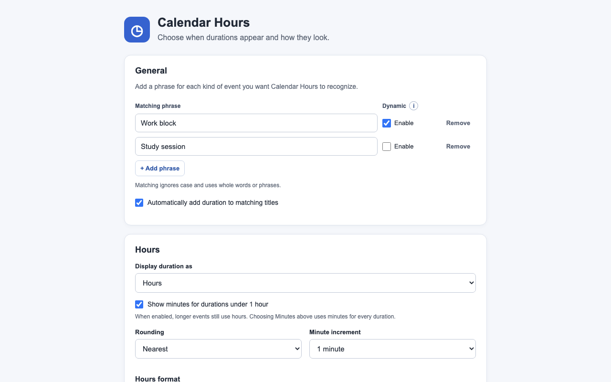

# Calendar Hours

[](https://github.com/austinkimchi/calendar-hours/actions/workflows/ci.yml)


Calendar Hours adds the elapsed time to Google Calendar event titles. A 10:15am–1:25pm event can become **Work session (3.17 hours)**. It works in Chrome and Microsoft Edge.

## Workday import (preview)

Calendar Hours adds **Auto-fill from Calendar** as the first item in **Actions** to **Enter Time** on `www.myworkday.com`. Workday interfaces vary by organization; the adapter currently supports the English Day/Week calendar and In/Out time-entry form.

1. Load or reload `extension/` in Chrome or Edge, allow its Workday site access, and refresh the Workday tab.
2. Open extension settings → **General → Google Calendar** and connect once. The same connection supports title updates and Workday import; event access and read-only calendar-list access are requested together. Existing connections with both permissions are reused. Older event-only connections need one explicit upgrade. OAuth remains limited to registered extension IDs and Google test accounts.
3. In **Workday import**, choose one or more calendars, enter an independent matching phrase such as `Work block`, choose the Workday time zone from the dropdown, and enable/save the import settings. Refresh calendars reads the shared connection without opening another authorization flow.
4. In Workday, display the desired week, previous week, or single day and choose **Actions → Auto-fill from Calendar**. The extension fetches that exact date range and saves matching blocks through Workday's normal **OK** action. The status banner reports results, aligns with Actions, and can be dismissed with its × button. A new import shows a new message.

Matching ignores case and uses the same whole-word/phrase mechanism as title formatting. Calendar start/end times are used without duration rounding; lunch gaps remain gaps. Only completed blocks are included by default, with an opt-in for unfinished/future blocks. Repeating calendar events are expanded into their instances.

Exact existing entries are skipped on rerun. **Overwrite existing times to match calendar** replaces an overlapping, unsubmitted Workday draft's times with the Calendar block's times. It is on by default; a previously saved off choice is preserved. Each update must match exactly one draft of the configured Time Type to one calendar block. Submitted entries, other time types, and overlaps involving multiple existing or calendar blocks remain for manual correction. Deleted calendar events and blocks moved entirely outside their previous times do not remove old Workday entries.

### Calendars and breaks

Select up to ten calendars. Reads use at most three concurrent requests, and an unreadable selected calendar stops the import before any writes. Existing single-calendar settings migrate automatically; unavailable saved calendars remain visible for correction.

**Meal automation is unavailable in this release.** The prototype controls are hidden and previously saved meal flags are disabled at runtime. Work intervals are imported as recorded; breaks must already be excluded from the matching work events. A separate nonmatching Lunch event or a description containing Meal does not shorten a work block or change its Out Reason. A 10 AM–6 PM work event therefore imports eight hours. To import 7.5 worked hours with a noon break, record the actual work intervals as 10 AM–noon and 12:30–6 PM. Set or check payroll-specific clock-out reasons in Workday. Existing entries created by a meal prototype are not merged or deleted automatically.

The meal-description work remains on its paused branch while payroll behavior is clarified. The backend performance experiment is also excluded from this release.

New entries have **blank comments by default**. **Import event descriptions as comments** optionally copies Google Calendar's Description field as plain text, up to 1,000 characters, when adding or updating an entry. With it off, updates preserve existing comments. With it on, the description replaces the comment, including clearing it when the description is empty. Event titles are used for matching, never as comments.

Overlapping source blocks are merged to avoid double-counting; adjacent blocks remain separate. Overnight, sub-minute and daylight-saving transition blocks require manual entry. A changed view or unexpected form stops the import. Successfully saved entries remain unsubmitted, including after a partial failure. **The extension never clicks Review or submits a time card.**

## Features

- Add a duration with a title suggestion, `/hours`, a keyboard shortcut, or the extension popup.
- Display hours or minutes, with custom rounding, increments, units, and title templates. Short events can switch to minutes automatically.
- Match phrases such as `Work block` and enable **Auto-update** separately for each phrase. Titles with an existing duration can also update after time changes.
- Connect Google Calendar once in General (or on the first-install welcome page) for title saves and Workday import. Connection changes preserve feature preferences: turn on **Use faster saves** or **Enable Workday import** separately. The regular Calendar editor method remains available without a connection.

## Preview



## Getting Started

To try the current source build, load [`extension/`](extension/) as an unpacked extension in Chrome or Edge. Refresh any open Google Calendar tabs after reloading the extension. [Store publication details](STORE_LISTING.md) are tracked separately.

Open a timed event, enter its start and end times, then type `/hours` in the title or press **Enter** or **Tab** to accept the faint inline duration suggestion. Accepting the suggestion only updates the title; save the event in Calendar afterward. Turn off **Show inline duration suggestions** in More options to hide the hint. Settings let you customize the format and matching phrases. Hover over a setting label or focus its field for routine help; key actions keep an ⓘ button. Tooltips do not shift the page and close immediately when the pointer leaves their label or icon. Press Escape or tap elsewhere to dismiss them.

Google Calendar connection requests use one authorization flow for both permissions and do not force repeat consent. Google may still require account selection, a missing permission, or renewed authorization. Disconnecting removes the shared connection for all features without erasing their settings.

Google Calendar API sign-in is currently limited to the project's OAuth test users. Broader distribution requires Google's OAuth review.

## Time zones

Time zone detection is automatic. Calendar Hours follows Google Calendar’s primary display zone and an event’s own start/end zones when available; otherwise it reads the device’s current zone. It recalculates from IANA zone rules for the event date, including daylight saving time. It does not change Calendar or system settings or request location access. If Calendar is kept in your home zone while traveling, the extension follows that choice.

Repeated or nonexistent clocks during a daylight-saving transition cannot be resolved from the editor alone, so the title is left unchanged. [Implementation and verification notes](TIME_ZONE_TESTING.md) describe detection and its limits.

## Development

```bash
npm ci
npm test
npm run package
```

Workday coverage includes multi-calendar fetching, exact intervals, overlap updates, saved-setting migration, disabled meal prototypes, form transitions, and duplicate-free reruns through simulated Workday forms.

CI runs the tests and checks the package on pushes and pull requests. The package script writes a versioned ZIP under `dist/` with `manifest.json` at its root.

## Project Notes

- [Changelog](CHANGELOG.md)
- [Privacy and data use](PRIVACY.md)
- [Store listing and release status](STORE_LISTING.md)
